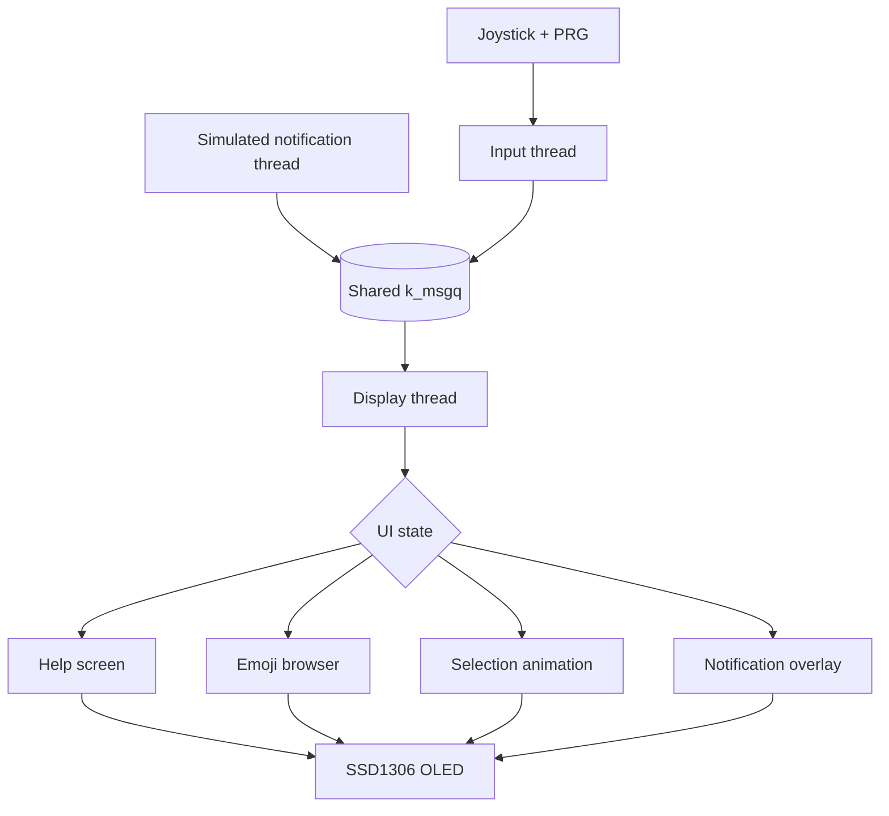

## Build Command
```powershell
python .\build.py -b --app 06_emoji_notification_center --pristine -j 12
python .\build.py -f --app 06_emoji_notification_center --port COM13
python .\build.py -m --port COM13
```


## Flow Diagram
