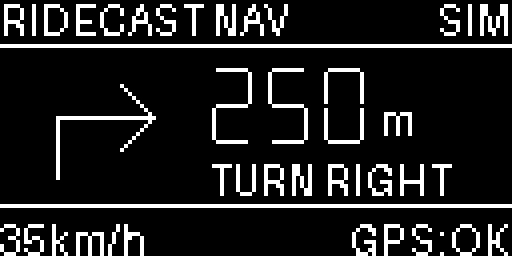
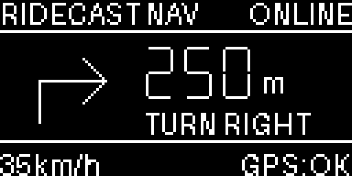

# RideCast — Heltec ESP32 Navigation Prototype

**Target:** Heltec WiFi LoRa 32 V2 (`heltec_wifi_lora32_v2/esp32/procpu`) · Zephyr · SSD1306 128×64 OLED  
**Demo goal:** Receive navigation directions over Wi-Fi and present them on the onboard OLED.  
**Current delivery:** Phase 0 OLED implementation plus an **opt-in Wi-Fi/TCP test path** for Phase 1. Not yet hardware-verified on this target.

> **Development hardware change only.** RideCast and the logical Cluster/Host run on the same ESP32 now, but remain logically independent. Future CC3351/STM32 uses the same business-level contracts; radio integration must still be ported and validated. BLE and production authentication remain out of scope for this prototype.

## Screen design (128×64 monochrome)

The left picture is the initial **SIM** screen you can run immediately. The right is the **ONLINE** layout, which the firmware only shows when Wi-Fi is associated **and** a test TCP client is connected. These illustrations are programmatically drawn 128×64 previews, **not photos or proof of actual hardware output**.

| Phase 0 — simulated navigation | Phase 1 — Wi-Fi + TCP peer |
|:--:|:--:|
|  |  |

Pixel layout overview:

```text
128 x 64 pixels
+---------------------+
| RIDECAST NAV    SIM |
|---------------------|
|       250 m         |
|   ->  TURN RIGHT    |
|---------------------|
| 35km/h      GPS:OK  |
+---------------------+
```

`heltec_graphic.c` owns the actual OLED rendering: header/status, drawn turn arrow, custom 7-segment distance digits, instruction, speed and GPS indicator. All rendering happens in a single app thread. If Wi-Fi is disconnected it shows `OFF`; if associated but no TCP client it shows `WIFI`; `ONLINE` requires the TCP peer. When simulation is enabled, the label is **SIM**, never falsely **ONLINE**. The graphic isn't a full OpenStreetMap image; it is turn-by-turn navigation suitable for this display size.
The preview images are included in the repository; to regenerate them on your PC: `python -m pip install Pillow` then `python apps/ridecast_heltec_demo/tools/make_oled_preview.py`.

## Phase-by-phase plan (November prototype)

| Phase | Target | Deliverable | Acceptance check |
|---|---|---|---|
| **0 — OLED** | First | SSD1306 initialization and `heltec_graphic.h/.c`; simulated navigation screens | Power on; `250 m` / right turn / `35 km/h` visible; other turn screens rotate every 3.5 seconds |
| **1 — Wi-Fi** | Next | ESP32 joins an existing 2.4-GHz WPA2 router; association, retry, TCP port 5050 | Console reports connected, IP available via Zephyr net shell; Windows TCP `PING` → `PONG` |
| **2 — Navigation RX** | Next | Windows Python `NAV` simulator; line buffering and field validation; UI queue | Send `NAV,RIGHT,250,35,1`, get `ACK,NAV`, OLED updates; invalid line gets `ERR,FORMAT` |
| **3 — Routing** | After 2 | Replace demo text parsing with RideCast wire codec and routing contracts | Valid content reaches logical Host; invalid messages rejected; command/event IDs remain provisional |
| **4 — Host & navigation services** | After 3 | Separate RideCast receive, navigation state and cluster UI; introduce HELLO/GET_CAPABILITIES/GET_SNAPSHOT | Both logical services operate on ESP32; no external host or UART needed |
| **5 — Reliability & migration** | End-of-November goal | Reconnect, stale-location handling, parser abuse tests, ESP32/CC3351 adapter abstraction | Disconnect/reconnect tests pass; demo instructions reproducible; TI migration documented |

Dates are planning targets, not guarantees. Phases 0–2 are *coded in this package* (Phase 1/2 are opt-in and require hardware validation). Phases 3–5 are **not** implemented here.

## Repository layout

```text
Zephyr-Ridecast/
├── common/
│   └── rc_err_sts.h                 # Existing shared RideCast error type
├── services/
│   └── connection/
│       ├── rc_connection_wifi.h/.c  # Existing generic Zephyr Wi-Fi manager
│       └── rc_connection_tcp.h/.c   # Existing Zephyr single-client TCP service
└── apps/
    └── ridecast_heltec_demo/
        ├── README.md
        ├── CMakeLists.txt
        ├── Kconfig
        ├── app.overlay
        ├── prj.conf
        ├── wifi.conf
        ├── local.conf.example
        ├── .gitignore
        ├── src/
        │   ├── main.c
        │   ├── heltec_graphic.h
        │   └── heltec_graphic.c
        ├── assets/
        │   ├── ridecast_nav_sim.png
        │   └── ridecast_nav_online.png
        └── tools/
            ├── make_oled_preview.py
            └── send_navigation.py
```

**Integration:** Install this folder under `apps/` in the existing RideCast repo. Keep the previously created `common/rc_err_sts.h` and `services/connection/` files alongside it. The source does **not** duplicate these shared modules.

## Phase 0 — Build and flash the OLED-only demo

The following PowerShell commands assume an initialized Zephyr workspace, with the project folder in the workspace as before and `west` available in your venv:

```powershell
# From your Zephyr workspace/repository root
west build -b heltec_wifi_lora32_v2/esp32/procpu apps/ridecast_heltec_demo -p always
west flash
```

If Zephyr isn't in the current workspace root, run from your actual Zephyr workspace and substitute the absolute application path.

**Expected behavior:** the OLED rotates four local examples, starting with **right turn, 250 m, 35 km/h**, then straight, left, arrived. The status shows `SIM` because no wireless client is connected. The earlier local Heltec demos needed I²C recovery and deferred SSD1306 initialization to avoid `-EBUSY`; this application follows that known sequence. The CMake file selects `ssd1306_128x64` and `app.overlay` enables the deferred display.

If the display is blank: inspect the serial log, confirm the exact V2 board target, and verify that the shield-generated display node and I²C wiring work using the previous OLED examples. The exact firmware/blob and toolchain prerequisites depend on the installed Zephyr release.

## Phase 1/2 — Build the Wi-Fi and navigation TCP demo

1. Copy `local.conf.example` to `local.conf`, set your **2.4 GHz WPA2** test router SSID/password, and keep the file out of Git.
2. Build with both extra config fragments:

```powershell
Copy-Item apps/ridecast_heltec_demo/local.conf.example apps/ridecast_heltec_demo/local.conf
# Edit apps/ridecast_heltec_demo/local.conf with your own values.
west build -b heltec_wifi_lora32_v2/esp32/procpu apps/ridecast_heltec_demo -p always -- -DEXTRA_CONF_FILE="wifi.conf;local.conf"
west flash
```

3. Find ESP32's DHCP IPv4 address from `net iface` in Zephyr shell (if enabled) or your router's client list. Your Windows computer must be on the same network, and the test Wi-Fi must allow peers to communicate.
4. Run the example test client:

```powershell
python apps/ridecast_heltec_demo/tools/send_navigation.py 192.168.1.100 --once
```

Replace `192.168.1.100` with the ESP32's real IP address.

Expected desktop exchange (test-only):

```text
TX PING
RX PONG
TX NAV,RIGHT,250,35,1
RX ACK,NAV
TX NAV,STRAIGHT,900,42,1
RX ACK,NAV
TX NAV,LEFT,120,24,1
RX ACK,NAV
TX NAV,ARRIVED,0,0,1
RX ACK,NAV
```

The OLED refreshes when a valid `NAV` message arrives; it does not render from inside the socket callback. Data older than five seconds is marked `GPS:NO`. The Wi-Fi demo uses the existing `rc_connection_wifi.c` / `rc_connection_tcp.c` via the standard Zephyr network management / socket APIs.

### Development-only TCP format

```text
PING\n                        -> PONG\n
NAV,<turn>,<meters>,<kmh>,<gps>\n -> ACK,NAV\n
```

`turn` is `RIGHT`, `LEFT`, `STRAIGHT` or `ARRIVED`; `meters` is 0–9999 (OLED shows up to 999), `kmh` is 0–240, and `gps` is `0` or `1`. TCP messages can be split across `recv()` calls. This code assembles complete lines and bounds line length to 95 characters. This **is not Document 04's final RideCast wire protocol** and does not imply that the provisional schemas have been approved.

### Security / safety boundaries

This is an **unauthenticated TCP development server**. Use a trusted isolated development LAN only; don't expose port 5050 to the internet or feed real private phone notifications/location histories into it. Don't use the GPS mock as a real driving-navigation system. The CC3351/BLE integration, credentials in secure storage, phone authentication and one-active-authorized-phone enforcement are production work for later phases.

## Portability rules

- `heltec_graphic.*` is deliberately board/display-specific and lives in the Heltec app, not `common/`.
- `services/connection/rc_connection_wifi.*` uses Zephyr network-management APIs; `rc_connection_tcp.*` uses Zephyr sockets. Neither should call Inventek or CC3351 registers directly.
- STM32/CC3351 needs a tested network driver, its own Devicetree wiring and potentially different Wi-Fi offload behavior. **Switching radio hardware is not guaranteed to be overlay-only.**
- Later replace the test-only TCP `NAV` line parser with `common/protocol/` + `common/contracts/` and a session-authenticated RideCast routing service.
- BLE remains out of scope but is reserved in our architecture for notifications/music metadata.

## Verification status

- UI content/logic: authored against Zephyr CFB API and prior local Heltec example initialization.
- Static/syntax checks: see accompanying delivery message.
- Hardware flash, actual SSD1306 output, ESP32 Wi-Fi association and TCP reception: **not tested on your physical board here**. Please share the build output or console log if Zephyr reports configuration errors; we will adjust to the precise version in your workspace.

### Reference documentation

- [Zephyr Heltec WiFi LoRa 32 V2 board](https://docs.zephyrproject.org/latest/boards/heltec/heltec_wifi_lora32_v2/doc/index.html)
- [Zephyr Wi-Fi management API](https://docs.zephyrproject.org/latest/services/connectivity/networking/api/wifi.html)
- [Zephyr Wi-Fi shell example](https://docs.zephyrproject.org/latest/samples/net/wifi/shell/README.html)
